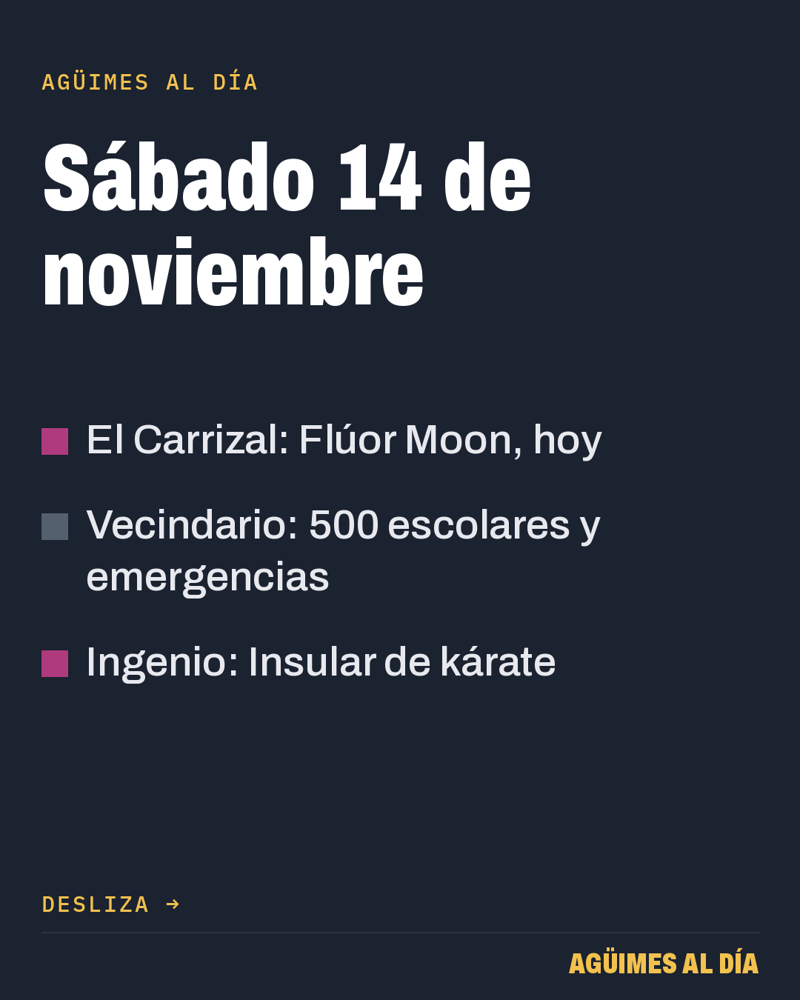
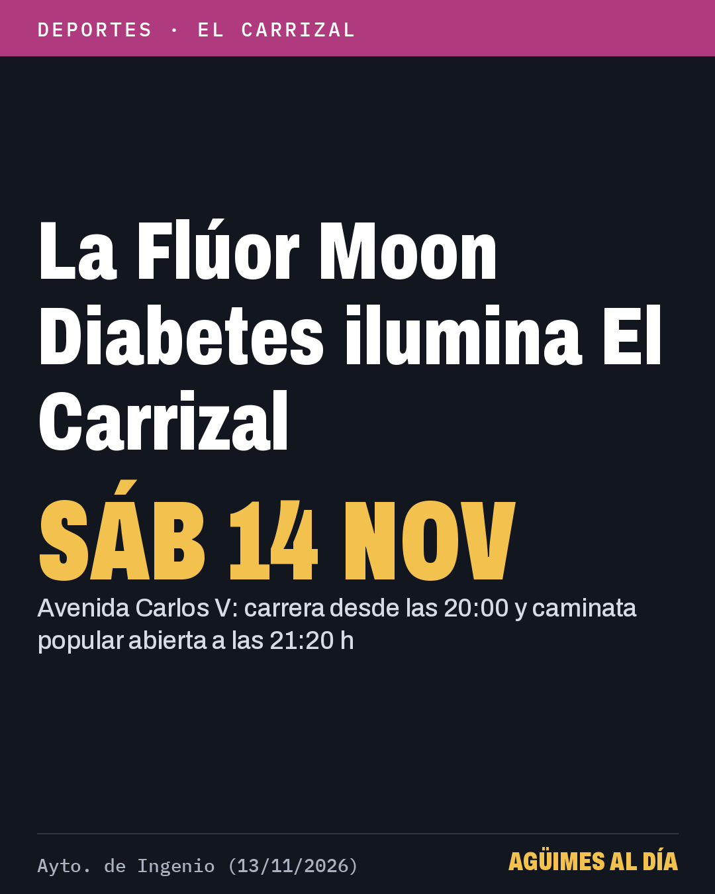
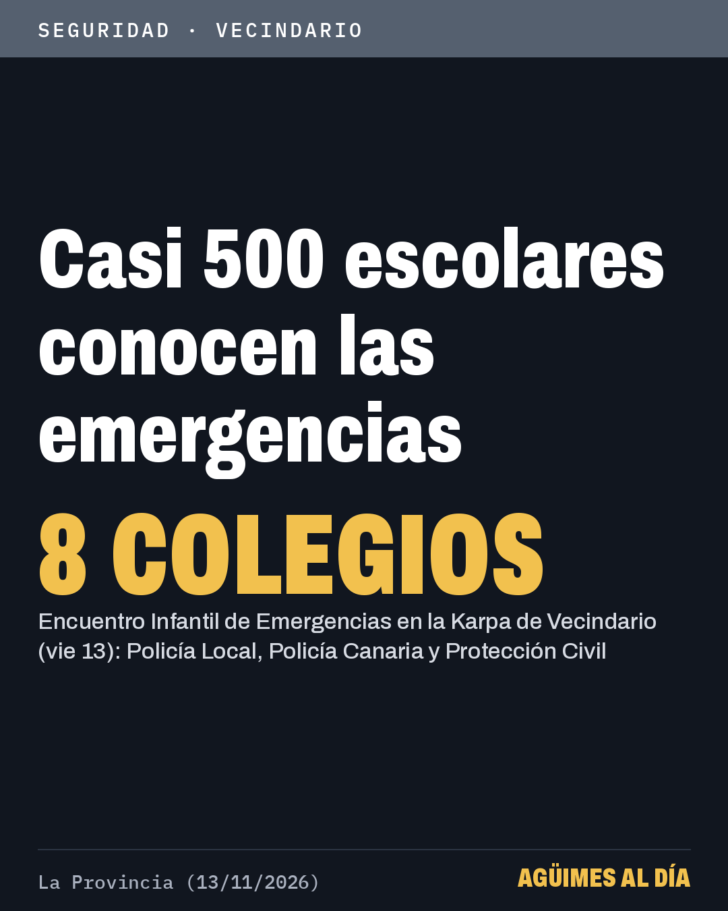

# Para publicar en Facebook

Actualizado: 2026-11-14 12:55 (hora de Canarias)

## URGENTE: publicar ya — Fin de la prealerta por inundaciones (PEINCA) en Canarias, 15:00 del vie 13

Imágenes, en este orden:


https://raw.githubusercontent.com/DronesJR/aguimes-imagenes/main/img/2026-11-13-1610-fin-peinca.png

Texto de la publicación:

```
Canarias: el Gobierno finaliza la prealerta por inundaciones (PEINCA) en Gran Canaria a las 15:00 de hoy, viernes 13.
👉 Sigue vigente la prealerta por desprendimientos (PLATECA): respeta las restricciones en las vías.

• La DG de Emergencias da por terminado el riesgo de inundaciones costeras, pluviales y fluviales por la borrasca Charles
• También finaliza la alerta por inundaciones en La Palma y la prealerta en el resto de islas
• Ante cualquier emergencia, llama al 112

Fuente: Gobierno de Canarias, DG Emergencias (13/11/2026) · Enlace en el primer comentario 👇
#Agüimes
```

Primer comentario:

```
🔗 Más información: https://www3.gobiernodecanarias.org/noticias/el-gobierno-de-canarias-finaliza-la-situacion-de-alerta-por-riesgo-de-inundaciones-en-la-palma/
```

## Publicar hoy sábado 14 a las 14:00 — Carrusel: 3 noticias (Flúor Moon El Carrizal, escolares y emergencias Vecindario, kárate Ingenio)

Imágenes, en este orden:


https://raw.githubusercontent.com/DronesJR/aguimes-imagenes/main/img/2026-11-14-1400-portada.png


https://raw.githubusercontent.com/DronesJR/aguimes-imagenes/main/img/2026-11-13-1900-fluor-moon.png


https://raw.githubusercontent.com/DronesJR/aguimes-imagenes/main/img/2026-11-14-1300-santalucia-emergencias.png


https://raw.githubusercontent.com/DronesJR/aguimes-imagenes/main/img/2026-11-13-1900-karate-ingenio.png

Texto de la publicación:

```
Sureste de Gran Canaria, sábado 14 de noviembre: 3 noticias de Ingenio y Santa Lucía.
👉 Desliza para ver cada una; los enlaces, en el primer comentario.

• El Carrizal: Flúor Moon Diabetes esta noche en la avenida Carlos V
• Vecindario: casi 500 escolares conocen los medios de emergencia
• Ingenio: 300 jóvenes en el Campeonato Insular de kárate

Fuente: Ayto. de Ingenio y La Provincia (13/11/2026) · Enlaces en el primer comentario 👇
#Ingenio
```

Primer comentario:

```
🔗 El Carrizal: Flúor Moon, hoy: https://ingenio.es/la-fluor-moon-diabetes-iluminara-el-carrizal-este-sabado-con-una-edicion-muy-especial-por-el-dia-mundial-de-la-diabetes/
🔗 Vecindario: 500 escolares y emergencias: https://www.laprovincia.es/gran-canaria/2026/11/13/cerca-medio-millar-escolares-santa-136420786.html
🔗 Ingenio: Insular de kárate: https://ingenio.es/el-karate-reune-a-300-jovenes-deportistas-en-el-campeonato-insular-de-categorias-base-celebrado-en-ingenio/
```
