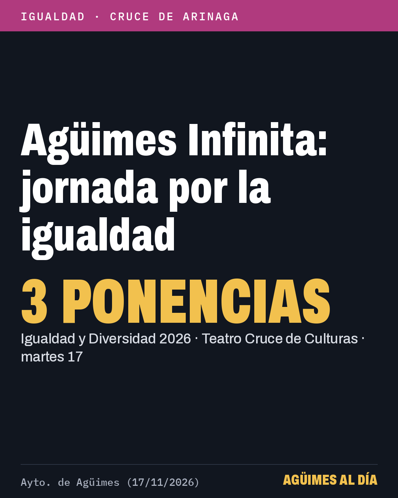
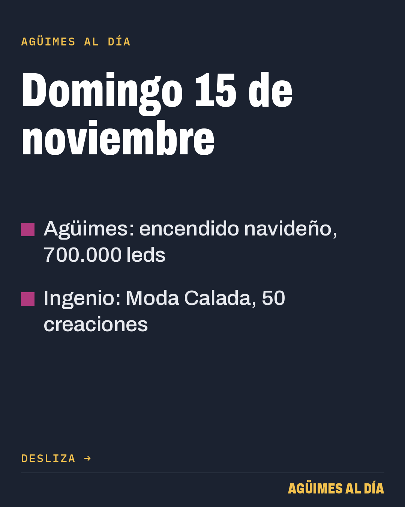
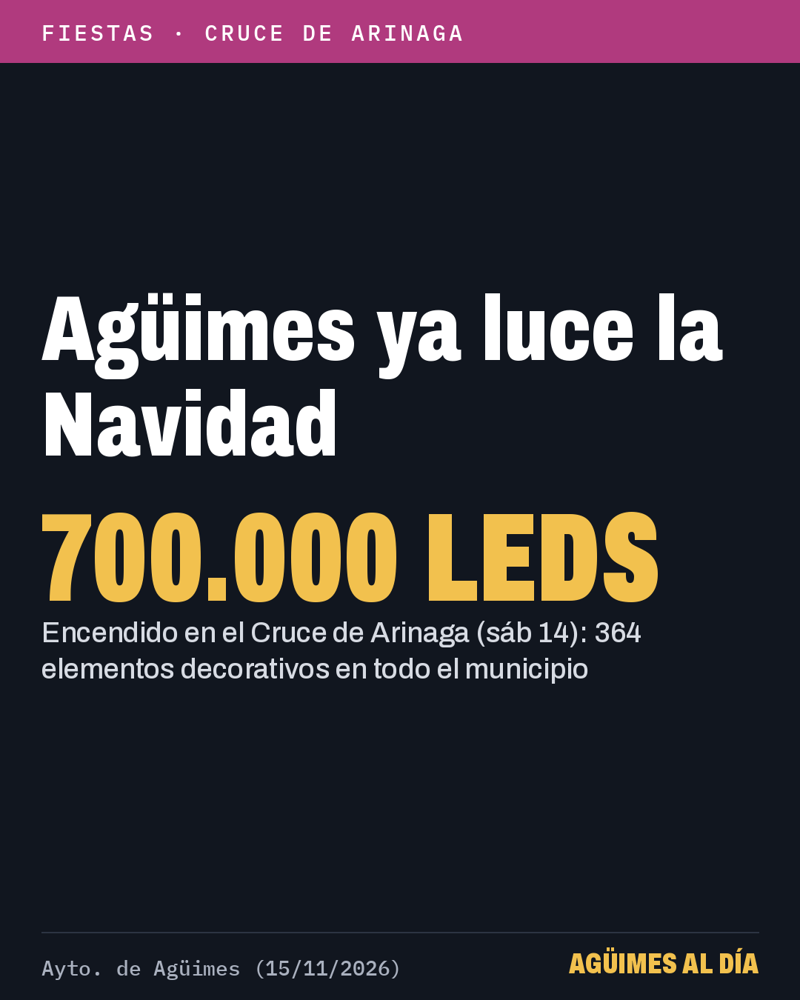

# Para publicar en Facebook

Actualizado: 2026-11-17 12:50 (hora de Canarias)

## Publicar hoy martes 17 a las 14:00 — Carrusel: 3 noticias (Agüimes Infinita, expo «Esta es mi historia» Santa Lucía, Gala Asdownsur Vecindario)

Imágenes, en este orden:


https://raw.githubusercontent.com/DronesJR/aguimes-imagenes/main/img/2026-11-17-1400-portada.png


https://raw.githubusercontent.com/DronesJR/aguimes-imagenes/main/img/2026-11-17-1300-aguimes-infinita.png


https://raw.githubusercontent.com/DronesJR/aguimes-imagenes/main/img/2026-11-16-2200-expo-testimonios.png


https://raw.githubusercontent.com/DronesJR/aguimes-imagenes/main/img/2026-11-16-2200-gala-asdownsur.png

Texto de la publicación:

```
Sureste de Gran Canaria, martes 17 de noviembre: 3 noticias de Agüimes y Santa Lucía.
👉 Desliza para ver cada una; los enlaces, en el primer comentario.

• Agüimes: jornada «Agüimes Infinita» por la igualdad
• Santa Lucía: exposición «Esta es mi historia»
• Vecindario: Gala Solidaria de Asdownsur, sáb 28

Fuente: Ayto. de Agüimes y Ayto. de Santa Lucía de Tirajana (16-17/11/2026) · Enlaces en el primer comentario 👇
#Agüimes #SantaLucía

```

Primer comentario:

```
🔗 Agüimes: jornada «Agüimes Infinita» por la igualdad: https://aguimes.es/la-jornada-aguimes-infinita-reune-a-alumnado-familias-y-ciudadania-en-torno-a-la-igualdad/
🔗 Santa Lucía: exposición «Esta es mi historia»: https://www.santaluciagc.com/el-ateneo-municipal-acoge-la-exposicion-esta-es-mi-historia-testimonios-de-resistencia/
🔗 Vecindario: Gala Solidaria de Asdownsur, sáb 28: https://www.santaluciagc.com/nia-y-antonia-san-juan-actuaran-en-la-gala-solidaria-de-asdownsur-el-28-de-noviembre-en-el-teatro-victor-jara/

```

## Publicar hoy domingo 15 a las 14:00 — Carrusel: 2 noticias (encendido navideño Cruce de Arinaga, Moda Calada Ingenio)

Imágenes, en este orden:


https://raw.githubusercontent.com/DronesJR/aguimes-imagenes/main/img/2026-11-15-1400-portada.png


https://raw.githubusercontent.com/DronesJR/aguimes-imagenes/main/img/2026-11-15-1300-encendido-arinaga.png


https://raw.githubusercontent.com/DronesJR/aguimes-imagenes/main/img/2026-11-15-0700-moda-calada-ingenio.png

Texto de la publicación:

```
Sureste de Gran Canaria, domingo 15 de noviembre: 2 noticias de Agüimes e Ingenio.
👉 Desliza para ver cada una; los enlaces, en el primer comentario.

• Agüimes: el Cruce de Arinaga enciende más de 700.000 leds en el encendido navideño
• Ingenio: 50 creaciones de calado y cinco diseñadores en el desfile de Moda Calada

Fuente: Ayto. de Agüimes y Canarias7 (15/11/2026) · Enlaces en el primer comentario 👇
#Agüimes #Ingenio
```

Primer comentario:

```
🔗 Agüimes: encendido navideño, 700.000 leds: https://aguimes.es/aguimes-da-la-bienvenida-a-la-navidad-con-un-multitudinario-encendido-de-luces/
🔗 Ingenio: Moda Calada, 50 creaciones: https://www.canarias7.es/canarias/gran-canaria/calado-ingenio-conquista-pasarela-obras-arte-cinco-20261114221622-nt.html
```

