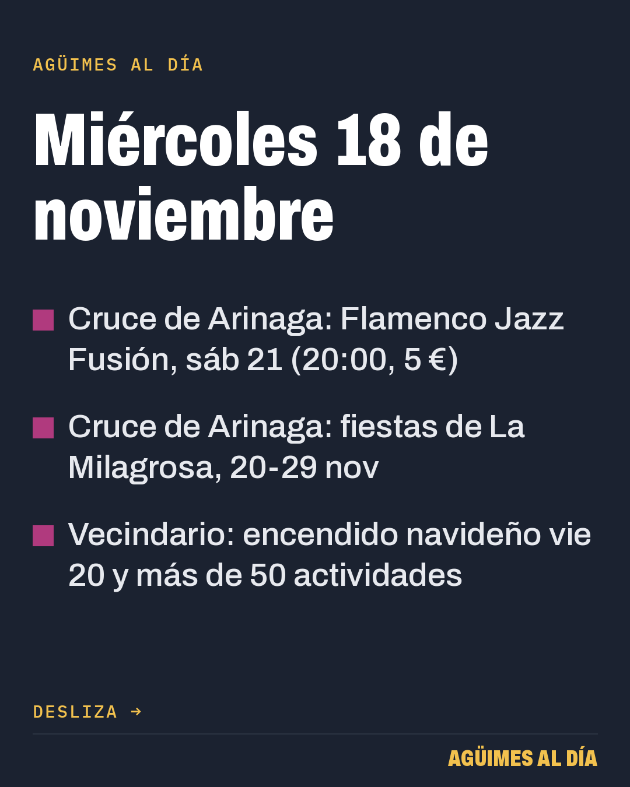
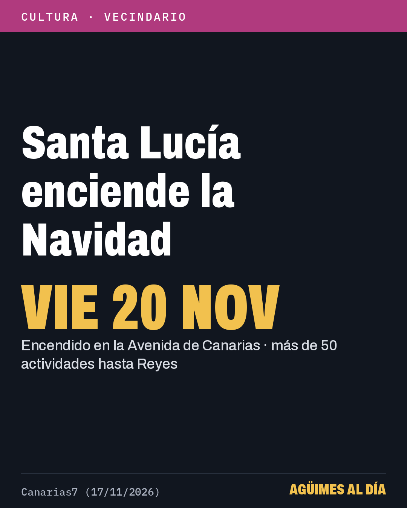
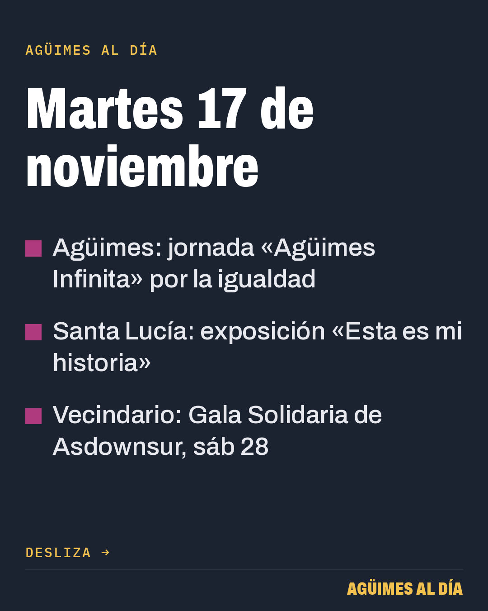
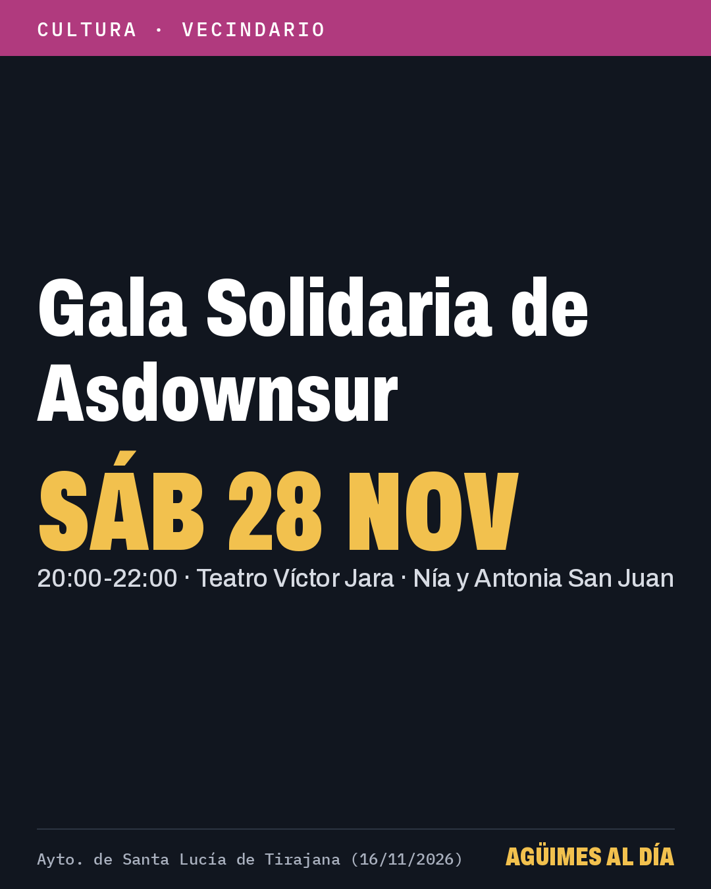

# Para publicar en Facebook

Actualizado: 2026-11-18 12:55 (hora de Canarias)

## Publicar hoy miércoles 18 a las 14:00 — Carrusel: 3 noticias (Flamenco Jazz Fusión, fiestas de La Milagrosa, encendido navideño de Vecindario)

Imágenes, en este orden:


https://raw.githubusercontent.com/DronesJR/aguimes-imagenes/main/img/2026-11-18-1400-portada.png


https://raw.githubusercontent.com/DronesJR/aguimes-imagenes/main/img/2026-11-18-1300-flamenco-jazz.png


https://raw.githubusercontent.com/DronesJR/aguimes-imagenes/main/img/2026-11-17-1600-milagrosa.png


https://raw.githubusercontent.com/DronesJR/aguimes-imagenes/main/img/2026-11-17-1900-navidad-santalucia.png

Texto de la publicación:

```
Sureste de Gran Canaria, miércoles 18 de noviembre: 3 noticias de Agüimes y Santa Lucía.
👉 Desliza para ver cada una; los enlaces, en el primer comentario.

• Cruce de Arinaga: Flamenco Jazz Fusión, sáb 21 (20:00, 5 €)
• Cruce de Arinaga: fiestas de La Milagrosa, 20-29 nov
• Vecindario: encendido navideño vie 20 y más de 50 actividades

Fuente: Ayto. de Agüimes y Canarias7 (17-18/11/2026) · Enlaces en el primer comentario 👇
#Agüimes #SantaLucía
```

Primer comentario:

```
🔗 Cruce de Arinaga: Flamenco Jazz Fusión, sáb 21 (20:00, 5 €): https://aguimes.es/el-teatro-cruce-de-culturas-acoge-un-viaje-musical-entre-el-flamenco-y-el-jazz/
🔗 Cruce de Arinaga: fiestas de La Milagrosa, 20-29 nov: https://aguimes.es/el-cruce-de-arinaga-celebrara-las-fiestas-de-la-milagrosa-del-20-al-29-de-noviembre/
🔗 Vecindario: encendido navideño vie 20 y más de 50 actividades: https://www.canarias7.es/canarias/gran-canaria/santa-lucia-prepara-navidad-medio-centenar-actividades-20261117164800-nt.html
```

## Publicar hoy martes 17 a las 14:00 — Carrusel: 3 noticias (Agüimes Infinita, expo «Esta es mi historia» Santa Lucía, Gala Asdownsur Vecindario)

Imágenes, en este orden:


https://raw.githubusercontent.com/DronesJR/aguimes-imagenes/main/img/2026-11-17-1400-portada.png


https://raw.githubusercontent.com/DronesJR/aguimes-imagenes/main/img/2026-11-17-1300-aguimes-infinita.png


https://raw.githubusercontent.com/DronesJR/aguimes-imagenes/main/img/2026-11-16-2200-expo-testimonios.png


https://raw.githubusercontent.com/DronesJR/aguimes-imagenes/main/img/2026-11-16-2200-gala-asdownsur.png

Texto de la publicación:

```
Sureste de Gran Canaria, martes 17 de noviembre: 3 noticias de Agüimes y Santa Lucía.
👉 Desliza para ver cada una; los enlaces, en el primer comentario.

• Agüimes: jornada «Agüimes Infinita» por la igualdad
• Santa Lucía: exposición «Esta es mi historia»
• Vecindario: Gala Solidaria de Asdownsur, sáb 28

Fuente: Ayto. de Agüimes y Ayto. de Santa Lucía de Tirajana (16-17/11/2026) · Enlaces en el primer comentario 👇
#Agüimes #SantaLucía

```

Primer comentario:

```
🔗 Agüimes: jornada «Agüimes Infinita» por la igualdad: https://aguimes.es/la-jornada-aguimes-infinita-reune-a-alumnado-familias-y-ciudadania-en-torno-a-la-igualdad/
🔗 Santa Lucía: exposición «Esta es mi historia»: https://www.santaluciagc.com/el-ateneo-municipal-acoge-la-exposicion-esta-es-mi-historia-testimonios-de-resistencia/
🔗 Vecindario: Gala Solidaria de Asdownsur, sáb 28: https://www.santaluciagc.com/nia-y-antonia-san-juan-actuaran-en-la-gala-solidaria-de-asdownsur-el-28-de-noviembre-en-el-teatro-victor-jara/

```

