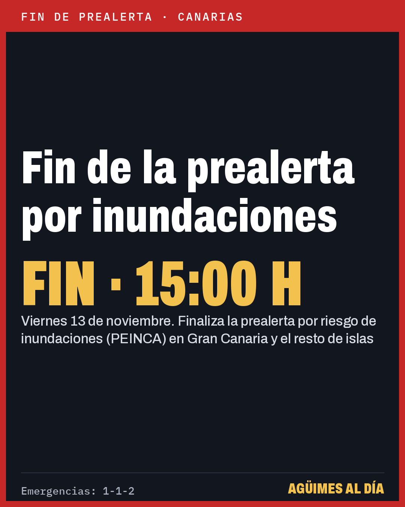
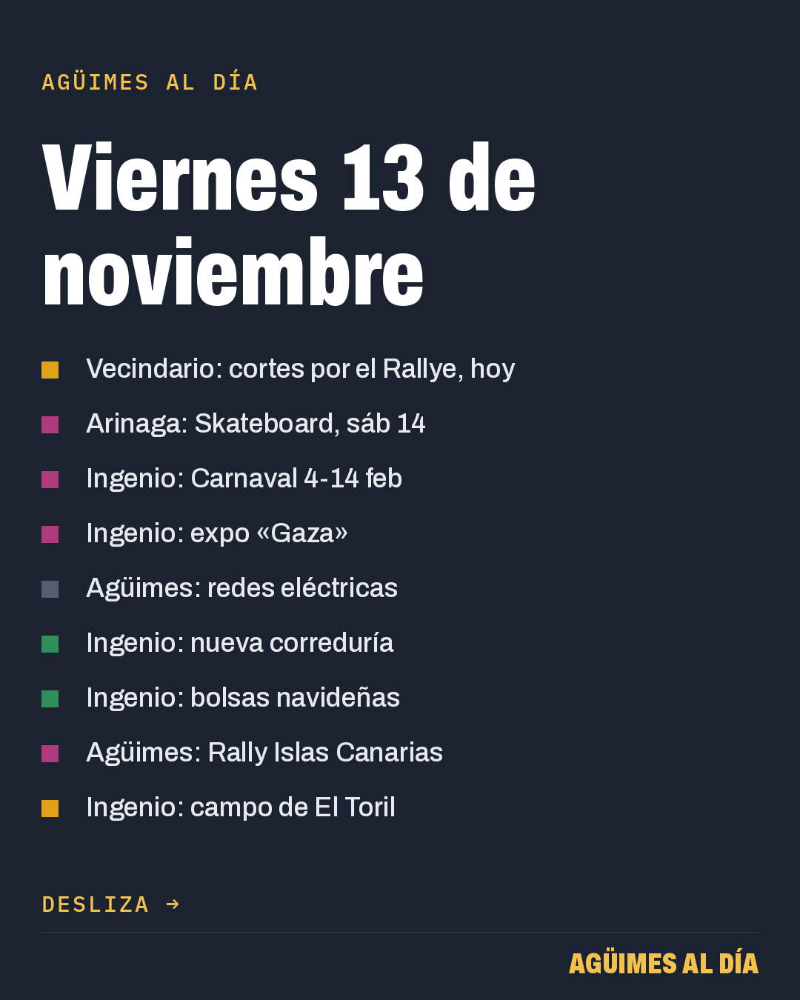
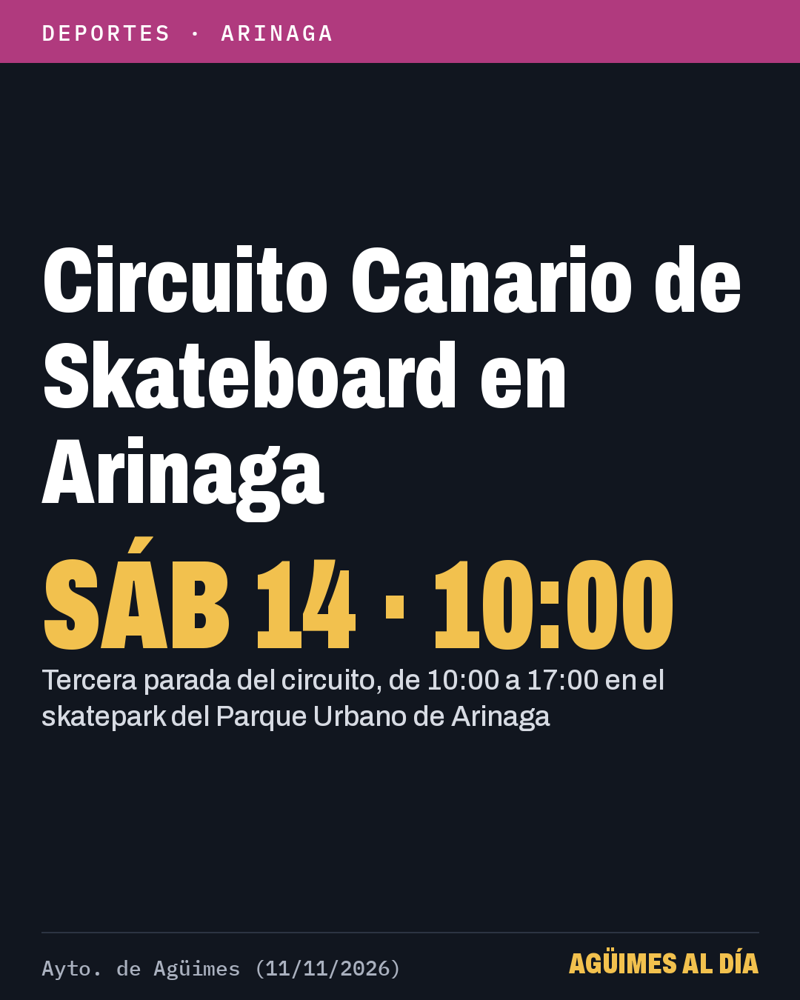
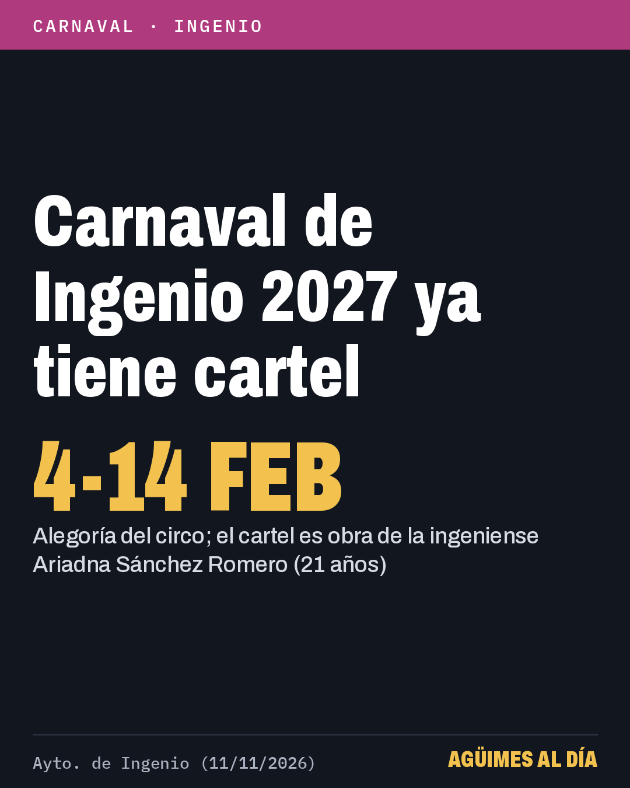
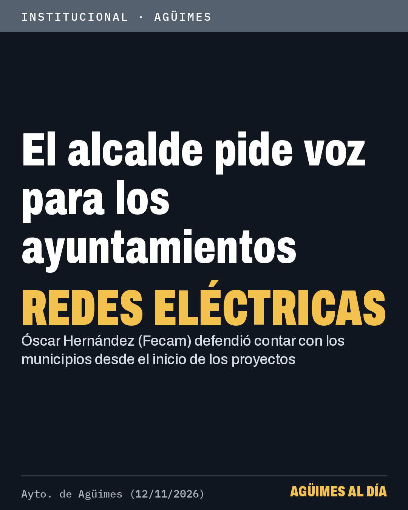
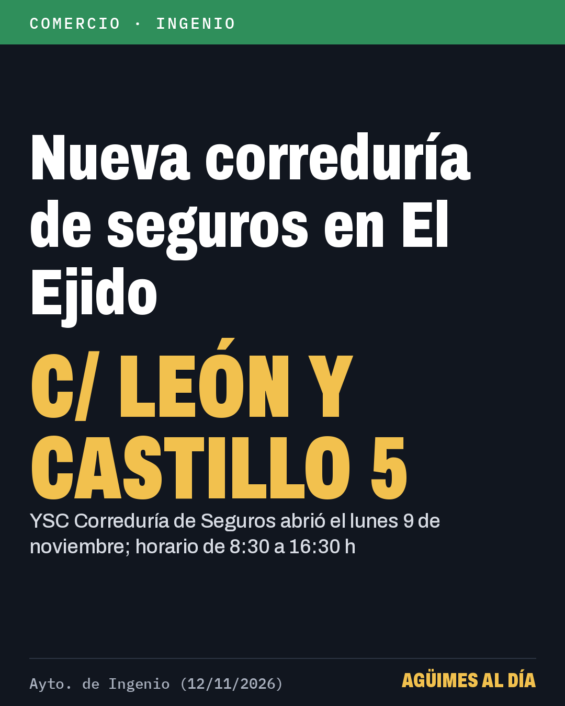
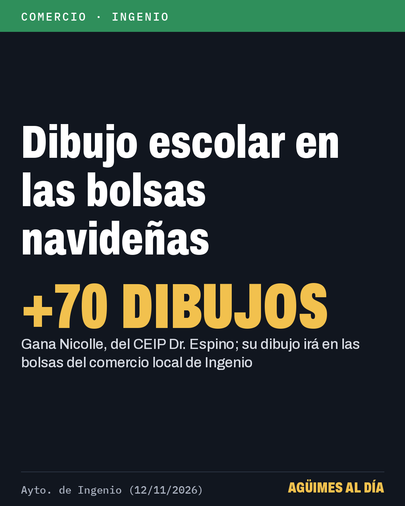
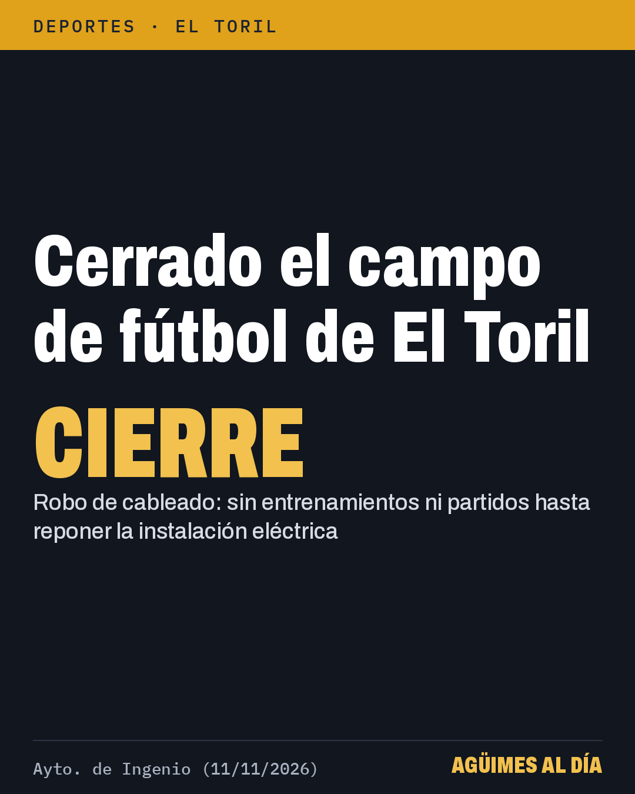

# Para publicar en Facebook

Actualizado: 2026-11-13 17:10 (hora de Canarias)

## URGENTE: publicar ya — Fin de la prealerta por inundaciones (PEINCA) en Canarias, 15:00 del vie 13

Imágenes, en este orden:


https://raw.githubusercontent.com/DronesJR/aguimes-imagenes/main/img/2026-11-13-1610-fin-peinca.png

Texto de la publicación:

```
Canarias: el Gobierno finaliza la prealerta por inundaciones (PEINCA) en Gran Canaria a las 15:00 de hoy, viernes 13.
👉 Sigue vigente la prealerta por desprendimientos (PLATECA): respeta las restricciones en las vías.

• La DG de Emergencias da por terminado el riesgo de inundaciones costeras, pluviales y fluviales por la borrasca Charles
• También finaliza la alerta por inundaciones en La Palma y la prealerta en el resto de islas
• Ante cualquier emergencia, llama al 112

Fuente: Gobierno de Canarias, DG Emergencias (13/11/2026) · Enlace en el primer comentario 👇
#Agüimes
```

Primer comentario:

```
🔗 Más información: https://www3.gobiernodecanarias.org/noticias/el-gobierno-de-canarias-finaliza-la-situacion-de-alerta-por-riesgo-de-inundaciones-en-la-palma/
```

## Publicar hoy viernes 13 a las 14:00 — Carrusel: 9 noticias del Sureste (Vecindario, Arinaga, Ingenio, Agüimes)

Imágenes, en este orden:


https://raw.githubusercontent.com/DronesJR/aguimes-imagenes/main/img/2026-11-13-1400-portada.png


https://raw.githubusercontent.com/DronesJR/aguimes-imagenes/main/img/2026-11-13-1300-rallye-historic.png


https://raw.githubusercontent.com/DronesJR/aguimes-imagenes/main/img/2026-11-11-1300-aguimes-skate.png


https://raw.githubusercontent.com/DronesJR/aguimes-imagenes/main/img/2026-11-11-1600-ingenio-cartel-carnaval.png


https://raw.githubusercontent.com/DronesJR/aguimes-imagenes/main/img/2026-11-12-1900-ingenio-expo-gaza.png


https://raw.githubusercontent.com/DronesJR/aguimes-imagenes/main/img/2026-11-12-1900-aguimes-fecam-redes.png


https://raw.githubusercontent.com/DronesJR/aguimes-imagenes/main/img/2026-11-12-1900-ingenio-ysc-seguros.png


https://raw.githubusercontent.com/DronesJR/aguimes-imagenes/main/img/2026-11-12-1900-ingenio-bolsas-navidad.png


https://raw.githubusercontent.com/DronesJR/aguimes-imagenes/main/img/2026-11-11-1300-aguimes-rally.png


https://raw.githubusercontent.com/DronesJR/aguimes-imagenes/main/img/2026-11-11-1900-el-toril-cierre.png

Texto de la publicación:

```
Sureste de Gran Canaria, viernes 13 de noviembre: 9 noticias de Agüimes, Ingenio y Santa Lucía.
👉 Desliza para ver cada una; los enlaces, en el primer comentario.

• Cortes de tráfico en Vecindario hoy, Historic Rallye
• Arinaga: Circuito Canario de Skateboard, sáb 14
• Ingenio: Carnaval 2027 del 4 al 14 de febrero
• Ingenio: exposición «Gaza, la mirada no silenciada»
• Agüimes: el alcalde pide voz para los ayuntamientos en redes eléctricas
• Ingenio: abre YSC Correduría de Seguros
• Ingenio: un dibujo escolar decorará las bolsas navideñas del comercio
• Agüimes prepara el 51º Rally Islas Canarias
• Ingenio: cerrado el campo de El Toril por robo de cableado

Fuente: Ayuntamientos de Agüimes, Ingenio y Santa Lucía de Tirajana (11-13/11/2026) · Enlaces en el primer comentario 👇
#Agüimes
```

Primer comentario:

```
🔗 Vecindario: cortes por el Rallye, hoy: https://www.santaluciagc.com/el-gran-canaria-historic-rallye-recorre-este-fin-de-semana-las-calles-del-municipio/
🔗 Arinaga: Skateboard, sáb 14: https://aguimes.es/arinaga-acoge-este-sabado-la-tercera-parada-del-circuito-canario-de-skateboard-2026/
🔗 Ingenio: Carnaval 4-14 feb: https://ingenio.es/el-carnaval-de-ingenio-2027-ya-tiene-cartel-anunciador/
🔗 Ingenio: expo «Gaza»: https://ingenio.es/gaza-la-mirada-no-silenciada-se-exhibe-en-la-sala-manolo-mherc/
🔗 Agüimes: redes eléctricas: https://aguimes.es/la-fecam-reivindica-el-papel-de-los-ayuntamientos-en-la-planificacion-de-las-redes-electricas/
🔗 Ingenio: nueva correduría: https://ingenio.es/ysc-correduria-de-seguros-abre-sus-puertas-en-ingenio-de-la-mano-de-la-emprendedora-yguanira-santana/
🔗 Ingenio: bolsas navideñas: https://ingenio.es/el-dibujo-de-una-alumna-del-ceip-dr-espino-adornara-las-bolsas-navidenas-del-comercio-local-de-ingenio/
🔗 Agüimes: Rally Islas Canarias: https://aguimes.es/aguimes-prepara-su-participacion-en-la-51a-edicion-del-rally-islas-canarias/
🔗 Ingenio: campo de El Toril: https://ingenio.es/el-robo-de-cableado-obliga-al-cierre-temporal-del-campo-de-futbol-de-el-toril-por-motivos-de-seguridad/
```
